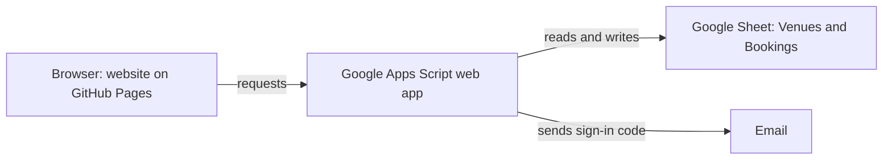
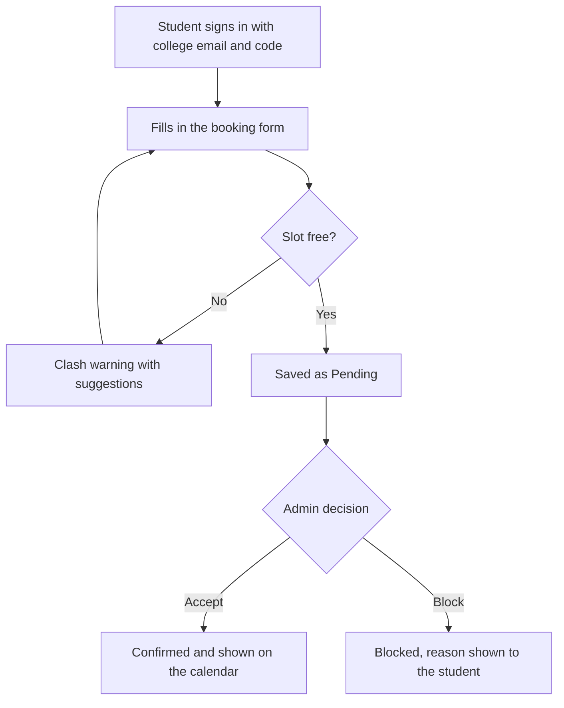

# NMAMIT Campus Event and Venue Booking Portal

A website where NMAMIT students and staff can look at one shared calendar and book campus venues for events. Admins accept or block each request. Data is stored in a Google Sheet.

**Author:** Pranav Purushotham Nayak  |  **USN:** nnm23is131
**Live website:** https://pranavnayak6.github.io/nmamit-booking-portal/
**Repository:** https://github.com/pranavnayak6/nmamit-booking-portal

---

## The problem

Venue bookings for events are often handled by paper requests and messages. This leads to double bookings, no clear status and no single place to see what is happening on campus. This project puts everything on one shared calendar with a simple request and approval process.

## Features

**For students and staff**
- Sign in only with an `@nmamit.in` or `@nitte.in` email, using a 6-digit code sent by email
- Shared month calendar and a day timeline showing all venues
- Filter by venue and search events by title
- Booking form with live clash warning, suggestions for other free venues or times, quick duration buttons and a capacity check
- Booking status: Pending, Confirmed or Blocked (with the admin's reason)
- "My bookings" list with cancel, and an Alerts button when a request is decided

**For admins (one or two accounts)**
- Separate sign-in with username and password
- Booking requests panel: accept or block, with an optional reason
- Dashboard cards: pending requests, events today, busiest venue
- Manage venues: add, edit, close or remove venues (name, capacity, location, facilities, colour)

**On phones**
- Control bar with Previous, Book and Next buttons that either thumb can reach
- Switch to place the bar at the top or the bottom of the screen
- Light and dark mode, large tap targets, clear focus outlines

## Venues

Sambhram, Shambhavi, Sadananda, Amphitheatre, Phalguni, Abhyuday Hall, Conference Room and Vista Lab. Admins can change this list from the website.

## How it works

## Technology

| Part | What is used |
|---|---|
| Website | HTML, CSS and JavaScript in a single file (`index.html`) |
| Backend | Google Apps Script web app (`Code.gs`) |
| Database | Google Sheets |
| Sign-in codes | Email sent through Google Apps Script |
| Hosting | GitHub Pages |

## Data stored in the Google Sheet

**Venues tab:** id, name, capacity, location, facilities, color, open

**Bookings tab:** id, title, venue, date, start, end, requestedBy, status, reason, purpose, attendees, seen, decidedBy, created

Status values: `pending`, `ok` (confirmed), `blocked`.

## Security

- Only college email domains can request a sign-in code
- Sign-in codes expire after 10 minutes and allow limited tries
- Admin passwords are stored as hashes, not in the sheet or the website
- Admin actions (accept, block, venue changes) are checked on the server side
- Students cannot see other people's emails or blocked requests
- Only one change is written to the sheet at a time, so two people cannot overwrite each other

## Project files

| File | Purpose |
|---|---|
| `index.html` | The whole website |
| `Code.gs` | The Google Apps Script backend |
| `README.md` | This file |

## Setup

1. Create a new Google Sheet named "NMAMIT Bookings DB".
2. Open Extensions > Apps Script. Delete the sample code and paste all of `Code.gs`. Save.
3. At the top of the code, set your two admin passwords in `ADMINS`. Save.
4. In the function dropdown choose `setup`, press Run, and allow the permissions (Advanced > Go to project > Allow). The tabs Venues and Bookings appear in the sheet.
5. Replace the passwords in `ADMINS` with `''` and save. They are already stored as hashes.
6. Deploy > New deployment > Web app. Execute as: Me. Who has access: Anyone. Deploy, then copy the Web app URL (ends in `/exec`).
7. Open `index.html` in a text editor, replace `PASTE_YOUR_WEB_APP_URL_HERE` with that URL, and save.
8. Open `index.html` to try it, or publish it with GitHub Pages (Settings > Pages > Branch: main).

After any change to `Code.gs`: Deploy > Manage deployments > Edit > Version: New version > Deploy.
Demo mode: set `SHOW_CODE_ON_SCREEN = true` to show the sign-in code on the login page instead of emailing it.
Keep the Google Sheet itself private. All access should go through the website.

## Limitations and future work

- Each action takes about 1 to 2 seconds because Google Sheets is not a fast database
- A free Google account can send about 100 sign-in emails a day
- The calendar refreshes every 20 seconds, not instantly
- Possible additions: week view, repeat bookings, bulk accept and block, decision history, venue photos, and a move to a full database such as Supabase

## Prompts used

I used Claude (an AI tool) to help write the code for this project. These are the main prompts I gave it, in order.

1. Design a website where NMAMIT users (nmamit.in and nitte.in) can book events and locations by looking at a common calendar.
2. Give me the website. (a working version)
3. Why I can't sign in. (screenshot attached)
4. Change the halls to Sambhram, Shambhavi, Sadananda, Amphitheatre, Phalguni, Abhyuday Hall, Conference Room and Vista Lab.
5. Make it easy to use on a phone for both left and right handed users.
6. Add an option to put the buttons bar on the top or bottom.
7. Add booking requests that an admin can accept or block. Only one or two admins, with a fixed username and password.
8. Let the admin edit, add and remove venues.
9. Make the design better and friendlier to use.
10. Use Google Sheets as the database and connect it to the website.
11. Explain step by step how to set up Google Sheets, Apps Script and GitHub Pages.

I did these parts myself: set up the Google Sheet and Apps Script, deployed it, tested everything, and uploaded the project to GitHub.
